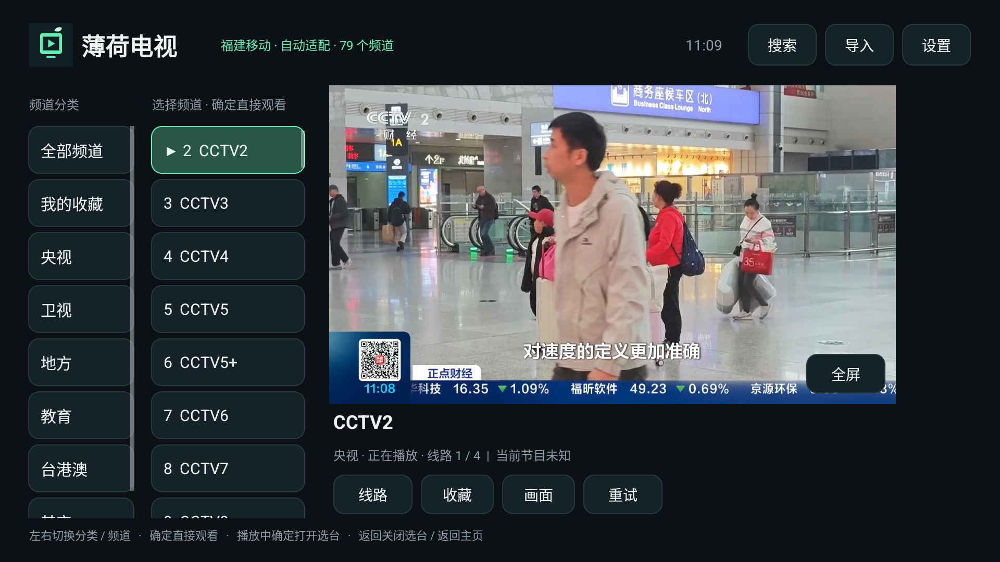
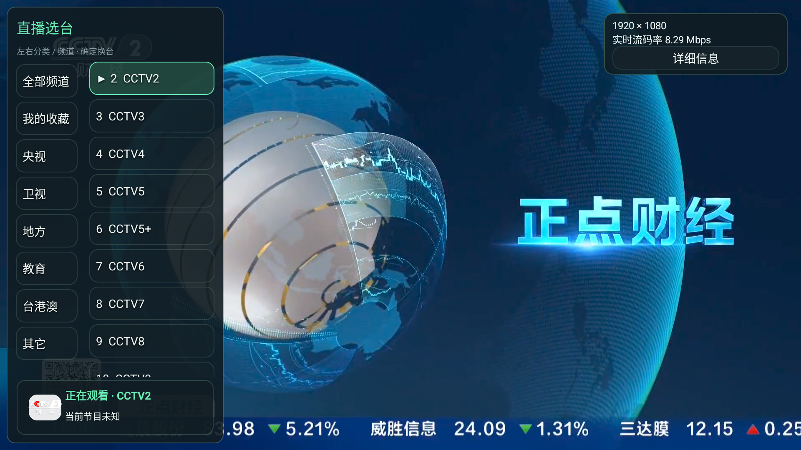
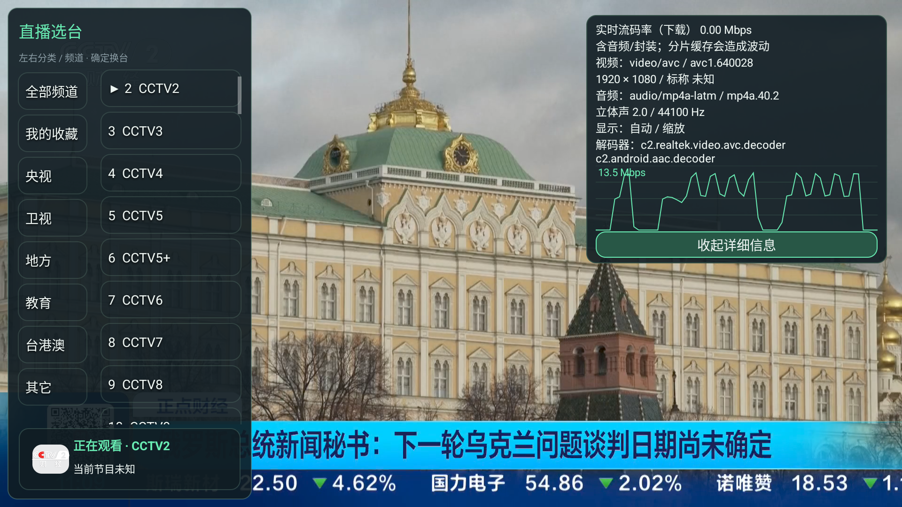

# 薄荷电视 · Mint TV

给 Android 电视盒子用的简洁直播软件：自动匹配宽带网络，优先播放可用的高清线路，拿起遥控器就能选台。

**[下载正式版本](https://github.com/microzjs/mint-tv/releases/latest)** · [使用与网络说明](docs/network-routing.md)

当前正式版：**[1.6.5](https://github.com/microzjs/mint-tv/releases/tag/v1.6.5)**。下载 Release 中的 `mint-tv-1.6.5.apk`，安装到电视盒子即可使用；已安装用户可直接覆盖升级，保留收藏和导入。

**后续升级**：设置 → 系统更新。检测到新正式版后自动下载并打开系统安装器；首次可能需要允许安装更新，安装时按系统提示确认。更新会校验包名、版本和签名，不会先卸载软件。

## 它能做什么

- **按网络找源**：识别省份和移动／电信／联通，匹配对应列表；识别或更新失败保留已有内容。
- **优先高清**：后台逐条试播，在已确认可用源中优先选择最高分辨率；失败自动尝试备用线路。
- **频道号连续**：隐藏确认失效的频道后，剩余频道从 1 开始连续编号，首页显示可选频道总数。
- **版本清晰、更新方便**：首页显示当前版本；设置内手动检查 GitHub 正式版，不新增常驻更新服务。
- **电视操作简单**：确定进入全屏，再按确定打开窄幅选台面板；深色半透明背景方便读字，30 秒无操作自动收起。频道列表只显示编号、名称和收藏标记。
- **节目和台标**：选台面板左下角显示正在观看频道的资料；主页播放说明合并为单行，为画面留出更多空间。
- **状态按需查看**：右上默认只显示分辨率与实时流码率；进入“详细信息”查看解码参数和最近 60 秒码率曲线。
- **手机扫码导入**：手机与盒子在同一局域网，即可发送直播列表文件或订阅链接，无需登录。
- **画面比例可修正**：每个频道可保存自动、16:9、4:3、裁切或拉伸设置。

不加入账号、广告、录制、多画面、最近观看或备份恢复菜单。主页为播放画面留出更多空间，预览框按 16:9 布局。

## 最新版实机界面 · 1.5.2

**主页：频道更简洁，播放画面更突出。** 分类和频道分栏排列，频道条目只显示连续编号、名称和收藏标记，不再显示线路数。右侧保留 16:9 预览，播放说明合并成一行。顶部显示当前匹配的网络及可选频道数。

**全屏选台：边看边选，少遮挡画面。** 播放时按确定，左侧打开横向收窄、接近全高的选台面板；深色半透明背景让文字更清楚。左下显示当前频道台标与节目资料，右上只显示分辨率和实时流码率。30 秒没有按键或触屏操作，面板与状态卡自动收起。

**详细状态：需要时再展开。** 在频道列表按右键，移到“详细信息”后按确定，可查看视频、音频、解码器和最近 60 秒的流码率曲线；按返回收起选台浮层。

以上为 1.5.2 在电视盒子上的实际截图。频道数量、可用线路和节目资料随网络及第三方数据变化；节目资料缺失时显示“当前节目未知”。

## 自动适配网络

首次联网识别省份和运营商，从 [CHINA-IPTV](https://github.com/xisohi/CHINA-IPTV) 获取对应地区列表。同网络复用检测结果，每日尝试更新；网络匹配变化后重新检测。1.6.4 起安装包不附带任何频道列表，首次必须联网识别省份与运营商，再从 GitHub 原始地址尝试获取对应列表；不再通过 CDN 或内置快照补齐。识别或下载失败时保持空列表，可手动选择地区或导入有权使用的源；升级已有缓存会保留。获取结果取决于网络连接与源服务状态。部分源仅在对应运营商宽带内可播。

匹配结果显示在主页顶部，例如上图的“福建移动 · 自动适配 · 79 个频道”。后台逐条检测频道源，在可用源中优先选择最高分辨率；确认全部线路失效的频道会隐藏，主动重新检测发现可用后再恢复显示。

## 遥控器怎么用

| 按键 | 操作 |
| --- | --- |
| 确定 | 主页进入全屏；全屏打开选台面板 |
| 左右／上下 | 浏览分类、频道；面板关闭时上下换台 |
| 频道列表右键 | 将焦点移至右侧详细信息按钮 |
| 菜单键 | 选择线路或调整画面比例 |
| 数字键 | 输入连续频道号，确定选台或稍候自动选择 |
| 全屏选台列表长按确定 | 收藏选中频道，再次长按取消；不打断当前直播 |
| 返回 | 收起面板或返回主页 |
| 无操作自动收起 | 普通选台 30 秒；展开详细信息后 60 秒 |

实时流码率根据下载字节计算，包含音频与封装；分片缓存可能造成瞬时波动，不是纯视频编码器的精确码率。

## 手机导入与连接

导入 → 订阅网址 → 手机扫码。支持 M3U／M3U8／TXT，文件最多 8 MB；窗口关闭或会话到期后停止接收。

节目单默认采用 [112114 XMLTV](https://epg.112114.xyz/)，可替换或关闭；台标采用列表、XMLTV 或公开台标库。第三方资料可能缺失或延迟，不能保证与直播完全同步。

## 安装与开发

Android 6.0+，面向 Android TV／Google TV 遥控器，兼容手机。覆盖安装保留收藏和导入；不要为了签名不匹配而直接卸载。正式发布指 GitHub 的非预览 Release，本次沿用设备已有签名，未更换证书。

[开发与构建](docs/development.md) · [本版发布说明](docs/release-1.6.5.md) · [历史版本记录](docs/validation-1.4.0.md)

播放器使用 AndroidX Media3，二维码使用 ZXing。界面和图标为原生实现。请仅使用有权访问的直播源。

## 免责声明

**1.** 此数据仅用于学习研究，不保证其合法性、准确性、有效性，请根据情况自行判断，本人对此不承担任何保证责任。

**2.** 由于此数据仅用于学习研究，您必须在下载后 24 小时内将所有内容从您的计算机或手机或任何存储设备中完全删除。若违反规定引起任何事件本人对此均不负责。

**3.** 请勿将此数据用于任何商业或非法目的，若违反规定请自行对此负责。

**4.** 此数据涉及应用与本人无关，本人对因此引起的任何隐私泄漏或其他后果不承担任何责任。

**5.** 本人对任何程序引发的问题概不负责，包括但不限于由程序错误引起的任何损失和损害。

**6.** 如果任何单位或个人认为此程序可能涉嫌侵犯其权利，应及时通知并提供身份证明，所有权证明，我们将在收到认证文件确认后删除此程序。

**7.** 所有直接或间接使用、查看此数据的人均应该仔细阅读此声明。本人保留随时更改或补充此声明的权利。一旦您使用或复制了此数据，即视为您已接受此免责声明。
