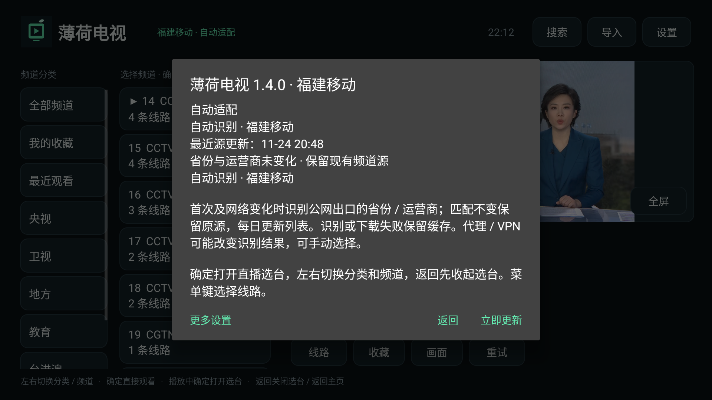
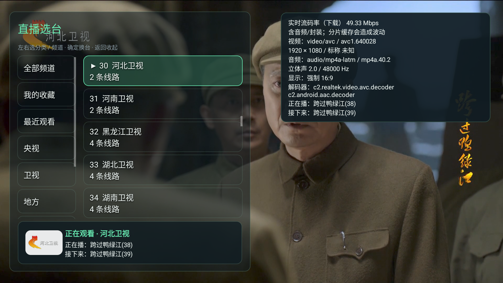
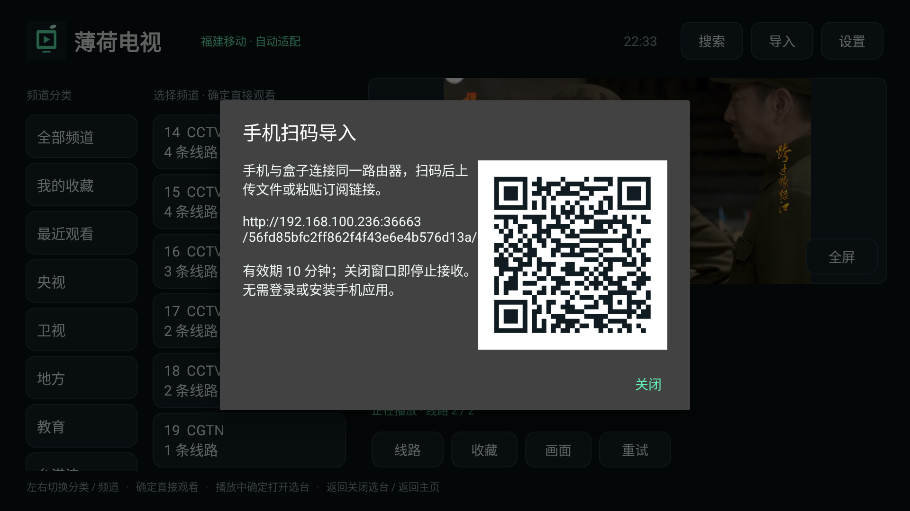

# 薄荷电视 · Mint TV

**为 Android 电视盒子设计的轻量 IPTV 播放器。自动适配宽带网络，打开电视就能选台。**

## 主要功能

- **自动匹配省份与运营商**：识别公网出口，优先使用对应地区的移动／电信／联通源；支持手动选择。初始备用列表为福建移动。
- **可用源内优先最高分辨率**：逐条静音试播，记录实际解码分辨率；优先选择已验证可播的最高分辨率源，失败自动尝试其他线路。
- **同网复用，失败保留**：省份、运营商不变时沿用检测缓存；每天尝试更新源，断网或下载失败保留已有列表。
- **遥控器直接选台**：数字频道号、收藏、最近观看；全屏按确定打开透明分类／频道面板，选台时直播继续播放。
- **节目名称与台标**：选台面板下方展示正在观看频道的当前／下一节目和台标；按需加载小图，不铺满大型节目墙。
- **手机扫码导入**：同一局域网扫描电视二维码，上传 M3U／M3U8／TXT 文件或粘贴订阅链接，无需账号或手机端安装。
- **按频道修正画面比例**：自动、强制 16:9、强制 4:3、等比裁切、拉伸填满；保存每个频道的选择。
- **隐藏失效频道与本地备份**：全部源确认失败才隐藏，支持单频道重检；导出订阅、收藏和设置，便于迁移设备。

## 自动匹配：先适配网络，再优选画质

首次联网识别**省份 + 运营商**，从 [CHINA-IPTV](https://github.com/xisohi/CHINA-IPTV) 的 `Unicast/<province>/<carrier>.txt` 获取对应列表。之后按以下规则工作：

| 情况 | 应用行为 |
| --- | --- |
| 省份、运营商相同 | 保留原有源及检测结果，日常仅检查更新 |
| 省份或运营商改变 | 成功取得新列表后切换，并重新检测 |
| 同频道有多个可用源 | 按试播分辨率优选，同分辨率保留原始顺序 |
| 识别、下载或节目单失败 | 保留已有数据，不清空可用内容 |
| 所有源确认失败 | 隐藏频道，用户重检成功后恢复 |

升级自旧版时，缺少分辨率的已知可用源会补测一次；不会因此清空收藏或强制恢复隐藏频道。未知、解码资源不足和中断不等同于源失效。画质优选依据实际试播结果，不能保证运营商网络中的所有源都可访问。

## 全屏选台，保持直播不中断

按一次确定打开左侧面板。左右切换分类和频道，上下浏览，确定后换台；返回先收起面板，再返回主页。面板保留透明背景及清晰焦点，下方展示**正在观看的频道**的节目资料；右上角显示实时下载流码率、声道、音视频格式与解码器。

| 遥控器操作 | 功能 |
| --- | --- |
| 主页确定 | 进入频道全屏播放 |
| 全屏确定 | 打开分类／频道选台面板 |
| 全屏上下（面板关闭时） | 快捷换台 |
| 全屏左键 | 打开频道分类 |
| 右键或菜单键 | 选择线路、重检当前频道、调整画面比例 |
| 数字键 | 输入频道号；等待约 1.4 秒或按确定选台 |
| 返回 | 取消输入、关闭面板、返回主页 |

宁夏卫视、河北卫视默认使用本次反馈对应的 16:9 修正，仍可在“画面比例”中切回自动；不会把全部历史 4:3 节目统一拉宽。

## 手机扫码导入

**导入 → 订阅网址 → 手机扫码**，手机和盒子连接同一路由器即可：

1. 扫描电视上的二维码，使用手机浏览器打开临时页面。
2. 上传不超过 8 MB 的 M3U／M3U8／TXT 文件，或发送 HTTP(S) 订阅链接。
3. 导入成功后直接在电视上选台；订阅网址参与每日更新，本地文件保留上传内容。

会话最长 10 分钟；关闭电视窗口或应用退到后台后停止接收。每次打开生成新地址，截图中的演示会话不再有效。访客 Wi-Fi 的设备隔离、代理或不同子网可能阻止局域网互访。

## 节目单、台标与数据

默认节目单使用 [112114 XMLTV 服务](https://epg.112114.xyz/)，可在设置中换为自己的 XMLTV／XMLTV.gz 地址或关闭。台标优先采用直播列表的 `tvg-logo` 与 XMLTV `icon`，缺失时尝试 [服务方公开台标库](https://github.com/sparkssssssssss/epg)。数据可能缺失、延迟或与直播进度不同，盒子时间应保持正确。

仅缓存每频道当前／下一节目，约每 6 小时尝试更新。台标只按需加载当前频道，小图内存缓存约 512 KB、磁盘缓存最多约 4 MB；节目单流式解析，不使用大型节目表数据库。

设置中的本地备份包含源、订阅地址、收藏、最近观看和频道设置。Android 10+ 电视盒子支持保存到 **下载 / MintTV**，避免部分 Google TV 只有占位文件选择器的问题；跨设备文件可使用完整的系统文件选择器。备份可能包含订阅凭据，请自行保管。

## 安装与开发

[下载薄荷电视 1.4.0 APK](releases/mint-tv-1.4.0.apk)（本次已安装文件；未重新签名）

包名 `cn.mint.tv`，最低 Android 6.0（API 23），兼容手机横屏；主要交互面向 Android TV／Google TV 遥控器。应用只在自身前台请求横屏，不修改系统旋转锁定。

- 本次安装文件保持原签名，保留应用数据。
- [GitHub Actions](https://github.com/microzjs/mint-tv/actions) 提供 Debug 测试包与 unsigned Release 构建产物；CI 临时 Debug 签名通常无法覆盖现有安装，不要通过直接卸载来规避签名问题。
- 独立正式签名、R8、构建步骤见 [开发与签名说明](docs/development.md)。私钥及口令不入库。

## 范围与验证

保持原生 Android 界面和单路前台播放；后台检测顺序执行，在切台及内存压力时让出资源。不加入账号系统、广告、多画面、录制和大型节目墙。

源可用性取决于运营商网络；公网出口识别可能受代理／VPN 影响，可手动适配。RTP／RTSP 目前需自行转换为 HTTP 代理源；不含回看、DRM 破解或付费订阅内容。

本次版本的构建、自动测试、盒子实测和未覆盖项见 [1.4.0 验证记录](docs/validation-1.4.0.md)。历史说明：[1.3.0](docs/lightweight-1.3.0.md) · [1.2.0](docs/health-1.2.0.md) · [1.1.0](docs/tv-1.1.0.md)。

## 数据与组件来源

- 频道数据：[xisohi / CHINA-IPTV](https://github.com/xisohi/CHINA-IPTV)。
- 节目与台标：[112114](https://epg.112114.xyz/) 及其公开数据仓库，或用户自行提供。
- 播放器：[AndroidX Media3](https://github.com/androidx/media)；二维码编码：[ZXing](https://github.com/zxing/zxing)。
- 原创原生界面和图标，最初风格参考 [LunaTV](https://github.com/MoonTechLab/LunaTV/releases)，未复制其代码或图片。

应用不提供账号订阅、收费频道或可用性承诺；请仅使用有权访问的数据源。
