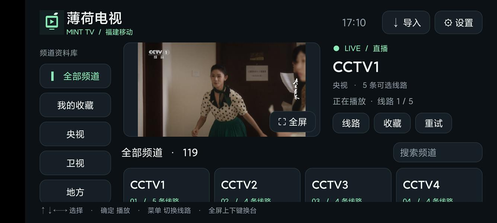

# 薄荷电视 · Mint TV

原生 Android IPTV 播放器，面向电视盒子和遥控器操作，兼容手机横屏使用。首次联网识别公网出口的省份和运营商，优先匹配该地区的移动／电信／联通频道源；识别失败保留缓存，初始备用列表为福建移动。



## 1.3.0 · 轻量存储与日常选台

- 大列表、检测任务、检测结果和小进度分桶保存；旧版数据在后台迁移，保留原 XML，日常界面读取内存缓存。
- 本地 JSON 备份 / 恢复订阅、收藏和设置；恢复前完整校验，检测结果按新设备网络重建。
- 隐藏频道管理和单频道重检；数字键输入稳定频道号，1.4 秒自动确认；新增最近观看（最多 20 个）。
- 可选 XMLTV / XMLTV.gz 节目单，仅保留每频道当前和下一节目，不添加节目墙或第二个前台播放器。
- R8 和资源压缩；正式 release 采用外部独立签名配置，不再默认使用 debug 签名。

使用、数据迁移、签名与验收边界见 [1.3.0 说明](docs/lightweight-1.3.0.md)。

## 1.2.0 · 持久检测与播放状态

首次匹配网络后，后台逐一静音试播当前快照的所有频道源，缓存首个成功地址与失败结果；同省同运营商不重复全量检测，中断可续检。所有源均确认失败的频道自动隐藏，设置中手动重新检测后成功恢复。全屏确定选台时，右上角显示实时下载流码率、声道、音视频格式和解码器。细节与测试范围见 [1.2.0 说明](docs/health-1.2.0.md)。

## 1.1.0 · 电视交互与网络适配

- 主页使用分类、频道和预览三栏；分类随焦点切换，频道按一次确定直接全屏。电视端再次打开可继续上次频道。
- 全屏按确定打开左侧双列选台面板；分类浏览不停止当前播放器，确定频道后才换台。返回先收起面板，再返回主页。全屏不显示右下角返回按钮。
- 首次、启动和网络变化时识别盒子公网出口；省份、运营商相同保留原源，仅在每日更新时刷新列表；地区或运营商变化后下载对应列表并原子替换缓存。
- 识别或下载失败不清空可用列表；可在设置中手动选择省份、运营商，或切回自动模式。
- 公网识别通过 HTTPS 访问 IPIP，失败时尝试 ipwho.is；不保存公网 IP，识别服务方会看到请求出口。代理／VPN 可能影响匹配，手动模式停止后续自动识别。

详见 [TV 交互与适配说明](docs/tv-1.1.0.md)。

## 1.0.1 更新

横屏请求仅限应用前台，退到后台时立即释放；正常退出移除应用任务。已在小米 14 验证切换至 Clash、Gmail 和桌面后保持竖屏。应用不改写系统旋转设置。方向问题的调试原因和回归步骤见 [方向回归记录](docs/orientation-regression.md)。

## 功能

- 从 [CHINA-IPTV](https://github.com/xisohi/CHINA-IPTV) 对应省份/运营商的 `Unicast/<province>/<carrier>.txt` 每日尝试更新；失败保留缓存，启动时补更。
- 同名频道合并多条线路，按原始顺序实际试播；报错、14 秒无首帧或缓冲超时自动切换到下一条，也可手动选择。
- 频道分组、搜索、收藏、预览与全屏播放。
- 导入 M3U / M3U8 / TXT 文件和 HTTP/HTTPS 订阅网址；支持 UTF-8 和 GB18030 编码。网址随每日任务更新，本地文件保留导入内容。
- Android TV 启动入口、方向键焦点和换台操作。

每日更新由 Android JobScheduler 调度，断网、休眠或系统后台限制会延后执行。运营商源能否播放取决于当前网络，部分源限福建移动宽带。内置列表快照在 2026-11-21 解析为 119 个频道、244 条线路，后续数量可能变化。

## 开发与构建

环境：JDK 17、Android SDK Platform 34、Build Tools 34.0.0。Gradle Wrapper 已包含在仓库，版本 8.9；Android Gradle Plugin 8.5.2。

1. 克隆本仓库，在 Android Studio 中打开根目录，或配置 `ANDROID_HOME` 指向本机 SDK。
2. 也可在本地新建 `local.properties`，设置 `sdk.dir`；该文件不提交。
3. 执行构建及检查：

```bash
# macOS / Linux
./gradlew :app:assembleDebug :app:lintDebug :app:testDebugUnitTest
bash scripts/test-playlist.sh

# Windows PowerShell
.\gradlew.bat :app:assembleDebug :app:lintDebug :app:testDebugUnitTest
.\scripts\test-playlist.ps1
```

APK 输出：`app/build/outputs/apk/debug/app-debug.apk`。安装：`adb install -r app/build/outputs/apk/debug/app-debug.apk`。

最低 Android 6.0（API 23），目标 API 34，包名 `cn.mint.tv`。

## GitHub 自动构建

推送、Pull Request 或在 Actions 页面手动运行 **Android build**，会运行解析测试、Android Lint、单元测试，并构建 Debug 与压缩后的 unsigned Release。成功后可在 **Artifacts** 下载 `mint-tv-debug` 或 `mint-tv-release-unsigned`。未配置独立签名的 release 不能直接安装。

正式签名通过四个本地环境变量提供：`MINT_KEYSTORE`、`MINT_STORE_PASSWORD`、`MINT_KEY_ALIAS`、`MINT_KEY_PASSWORD`。全部未设置时输出 unsigned Release；不自动退回 debug 签名。不将密钥、口令提交到仓库。详见版本说明。

`assembleCompat` 使用本机原 debug key，供已有开发版覆盖测试；它保留 R8 压缩，但并非正式签名发布包。换机器或 CI 的 debug key 通常不同，不能覆盖已有安装。

## 代码结构

| 路径 | 作用 |
| --- | --- |
| `app/src/main/java/cn/mint/tv/MainActivity.java` | 原生界面、遥控器交互、播放器和线路切换 |
| `app/src/main/java/cn/mint/tv/Playlist.java` | M3U/TXT 解析、频道合并和去重 |
| `app/src/main/java/cn/mint/tv/Store.java` | 订阅、缓存、导入与更新任务配置 |
| `app/src/main/java/cn/mint/tv/UpdateJob.java` | Android 每日后台更新任务 |
| `app/src/main/res/drawable/` | 原创薄荷电视图标和 TV banner |
| `tests/PlaylistTest.java`、`tests/NetworkProfileTest.java` | 独立于 Android 的解析和网络匹配规则测试 |

## 遥控器与使用

主页方向键移动焦点，确定直接全屏播放。全屏确定键打开左侧分类／频道面板，上下浏览、左右切换两列；确定换台，返回收起面板，再按返回回主页。未打开面板时上下快捷换台，左键打开分类，右键或菜单键选线路。菜单键可打开线路列表；手机可能截获该键，此时点击“线路”。右上角可导入、管理订阅或立即更新。详见 [使用说明](README.txt)。

## 验证与当前范围

2026-11-21 在小米 14 上验证了 CCTV1、CCTV2、安徽卫视播放，以及失效首源到第二条线路的自动切换、手动选线、全屏进出、网址和本地 TXT 导入、移除导入、更新任务及缓存。解析器测试和本地 release 构建、Lint 已通过。

1.1.0 已在 Android 14 / 1080p Google TV 盒子验证全屏选台、浏览分类时持续播放、确定换台与返回主页。现场识别福建移动，同网重新进入时保留原源。未逐条检测全部线路；跨省或换运营商的分支以单元测试覆盖，未实际迁移网络。包含 HLS、DASH 及常见 HTTP/UDP 媒体支持；RTP/RTSP 目前跳过，需要转换为 HTTP 代理源。1.3.0 增加可选当前/下一节目单；不含回看和录制。

频道数据来自 [xisohi/CHINA-IPTV](https://github.com/xisohi/CHINA-IPTV)，界面风格参考 [LunaTV](https://github.com/MoonTechLab/LunaTV/releases)，播放器使用 [AndroidX Media3](https://github.com/androidx/media)。应用为原生新实现，未复制 LunaTV 源码或图片。

