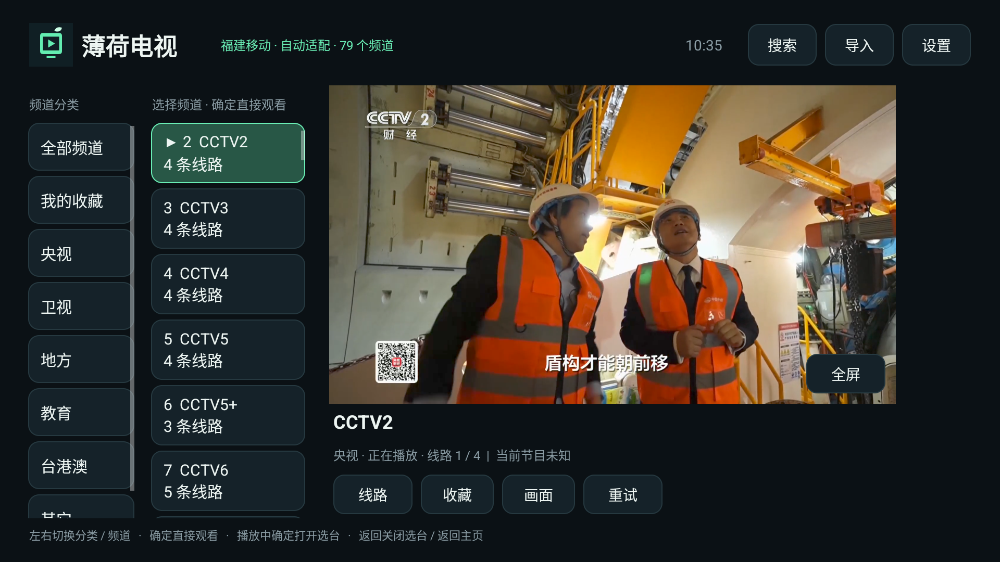
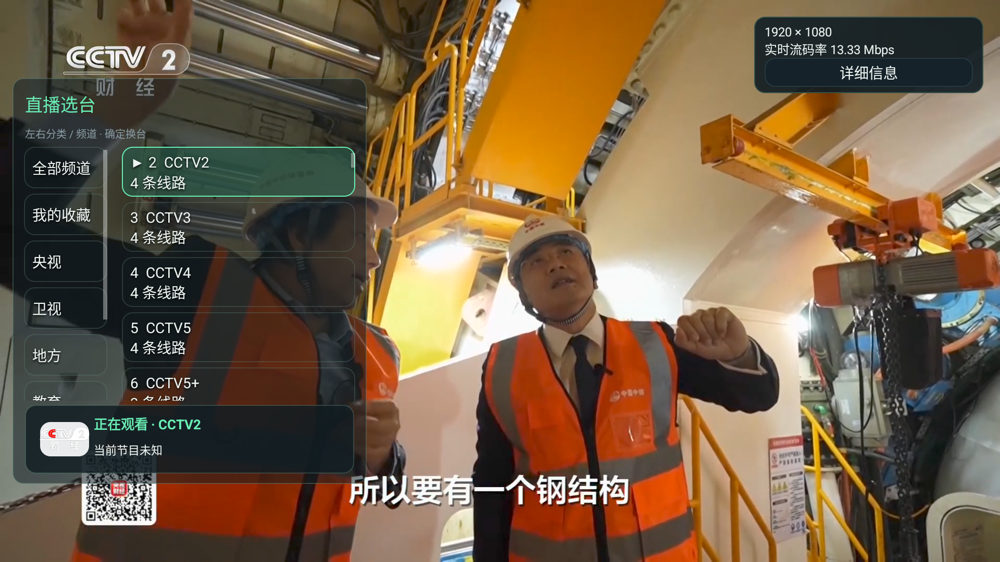
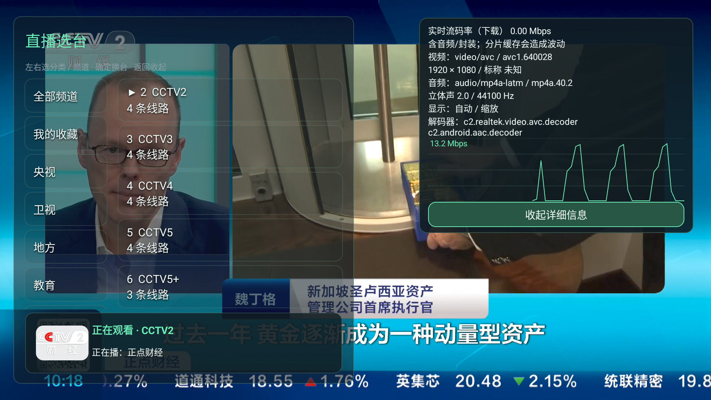

# 薄荷电视 · Mint TV

给 Android 电视盒子用的简洁直播软件：自动匹配宽带网络，优先播放可用的高清线路，拿起遥控器就能选台。

**[下载正式版本](https://github.com/microzjs/mint-tv/releases/latest)** · [使用与网络说明](docs/network-routing.md)

## 它能做什么

- **按网络找源**：识别省份和移动／电信／联通，匹配对应列表；识别或更新失败保留已有内容。
- **优先高清**：后台逐条试播，在已确认可用源中优先选择最高分辨率；失败自动尝试备用线路。
- **频道号连续**：隐藏确认失效的频道后，剩余频道从 1 开始连续编号，首页显示可选频道总数。
- **电视操作简单**：确定进入全屏，再按确定打开透明选台面板；保留分类、搜索和收藏。
- **节目和台标**：选台面板左下角显示正在观看频道的资料，不重复占用右侧空间。全屏浮层进一步缩小，主页播放说明合并为单行。
- **状态按需查看**：右上默认只显示分辨率与实时流码率；进入“详细信息”查看解码参数和最近 60 秒码率曲线。
- **手机扫码导入**：手机与盒子在同一局域网，即可发送直播列表文件或订阅链接，无需登录。
- **画面比例可修正**：每个频道可保存自动、16:9、4:3、裁切或拉伸设置。

不加入账号、广告、录制、多画面、最近观看或备份恢复菜单。主页为播放画面留出更多空间，预览框按 16:9 布局。

## 观看界面

## 自动适配网络

首次联网识别省份和运营商，从 [CHINA-IPTV](https://github.com/xisohi/CHINA-IPTV) 获取对应地区列表。同网络复用检测结果，每日尝试更新；网络匹配变化后重新检测。初始备用列表为福建移动，部分源只能在对应运营商宽带内播放。

## 遥控器怎么用

| 按键 | 操作 |
| --- | --- |
| 确定 | 主页进入全屏；全屏打开选台面板 |
| 左右／上下 | 浏览分类、频道；面板关闭时上下换台 |
| 频道列表右键 | 将焦点移至右侧详细信息按钮 |
| 菜单键 | 选择线路或调整画面比例 |
| 数字键 | 输入连续频道号，确定选台或稍候自动选择 |
| 返回 | 收起面板或返回主页 |

实时流码率根据下载字节计算，包含音频与封装；分片缓存可能造成瞬时波动，不是纯视频编码器的精确码率。

## 手机导入与直播直连

导入 → 订阅网址 → 手机扫码。支持 M3U／M3U8／TXT，文件最多 8 MB；窗口关闭或会话到期后停止接收。

直播和后台试播使用无显式代理的网络请求，优先使用非 VPN 网络；GitHub 更新仍使用普通网络路径。**软路由／Clash 的透明接管由路由规则决定，应用无法保证绕过。** 请按[网络说明](docs/network-routing.md)配置大陆 IP 直连。

节目单默认采用 [112114 XMLTV](https://epg.112114.xyz/)，可替换或关闭；台标采用列表、XMLTV 或公开台标库。第三方资料可能缺失或延迟，不能保证与直播完全同步。

## 安装与开发

Android 6.0+，面向 Android TV／Google TV 遥控器，兼容手机。覆盖安装保留收藏和导入；不要为了签名不匹配而直接卸载。正式发布指 GitHub 的非预览 Release，本次沿用设备已有签名，未更换证书。

[开发与构建](docs/development.md) · [本版发布说明](docs/release-1.5.1.md) · [历史版本记录](docs/validation-1.4.0.md)

播放器使用 AndroidX Media3，二维码使用 ZXing。界面和图标为原生实现。请仅使用有权访问的直播源。
